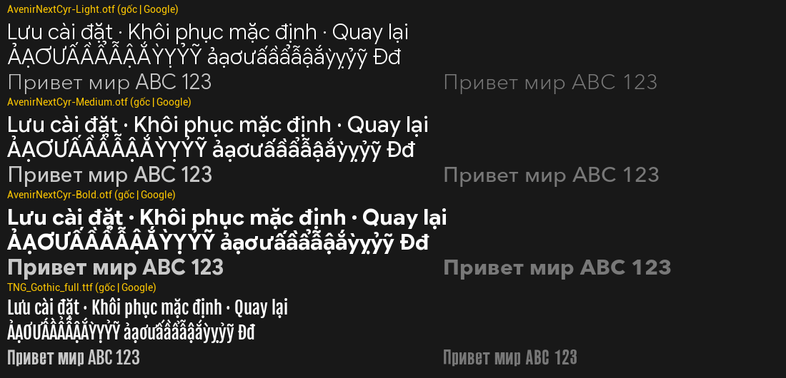

# 🎸 Hi-Fi RUSH — Bản Việt Hóa Toàn Diện (v1.0)

Bản Việt hóa hoàn chỉnh cho tựa game hành động nhịp điệu **Hi-Fi RUSH**, bao gồm **8.494 dòng** (hội thoại cốt truyện, giao diện, hướng dẫn chiến đấu, hồ sơ Vandelay, mô tả chip/kỹ năng...) cùng **bộ phông chữ tiếng Việt** đồng bộ theo đúng phong cách comic của game.

---

## 📥 Tải Xuống (Chọn 1 trong 3 gói phù hợp với bạn)

Bạn có thể tải tại trang **[Releases](https://github.com/vietnd69/Hi-fi-Rush-Viet-Hoa/releases)** hoặc tải trực tiếp trong thư mục [`dist/`](dist/):

| Gói cài đặt | Dung lượng | Mô tả & Đối tượng khuyên dùng |
| :--- | :---: | :--- |
| **[`HiFiRush_VietHoa_Setup.exe`](https://github.com/vietnd69/Hi-fi-Rush-Viet-Hoa/releases/latest/download/HiFiRush_VietHoa_Setup.exe)** | ~71 MB | **Khuyên dùng (1-Click):** Bộ cài tự động nhận diện thư mục game Steam, tự cài đặt đầy đủ chữ + phông chữ + Overdub loader + sửa lỗi kẹt Tutorial. Hỗ trợ gỡ cài đặt 1 chạm. |
| **[`HiFiRush_VietHoa_Pack_Full.zip`](https://github.com/vietnd69/Hi-fi-Rush-Viet-Hoa/releases/latest/download/HiFiRush_VietHoa_Pack_Full.zip)** | ~71 MB | **Gói giải nén thủ công (Đầy đủ):** Dành cho người không muốn chạy file `.exe`. Chỉ cần giải nén trực tiếp vào thư mục gốc của game `Hi-Fi RUSH`. |
| **[`HiFiRush_VietHoa_Pack_PakOnly.zip`](https://github.com/vietnd69/Hi-fi-Rush-Viet-Hoa/releases/latest/download/HiFiRush_VietHoa_Pack_PakOnly.zip)** | ~0.4 MB | **Gói `.pak` thuần (Chỉ phần chữ):** Chứa `Hibiki-WindowsNoEditor_9999_P.pak` + `.sig` kèm script cài đặt tự động cho người chỉ muốn dùng file `.pak`. |

---

## 🚀 Hướng Dẫn Cài Đặt

### Cách 1: Cài tự động bằng `HiFiRush_VietHoa_Setup.exe` (Nhanh & Dễ nhất)
1. Tải và mở **[`HiFiRush_VietHoa_Setup.exe`](dist/HiFiRush_VietHoa_Setup.exe)**.
2. Bộ cài sẽ **tự động quét ổ cài đặt của Steam** và điền sẵn đường dẫn thư mục `Hi-Fi RUSH`.
   - Nếu bạn cài game ở nơi khác, bấm nút **Chọn thư mục...** và chọn tới thư mục `Hi-Fi RUSH`.
3. Bấm **CÀI ĐẶT VIỆT HÓA** và đợi thanh tiến trình chạy tới 100%.
4. Mở game trực tiếp từ Steam (trong mục *Options → Language*, giữ ngôn ngữ chữ là **English** để hiển thị Tiếng Việt).
5. Khi muốn gỡ bỏ bản Việt hóa để về nguyên bản, mở lại `HiFiRush_VietHoa_Setup.exe` và bấm **Gỡ Việt hóa**.

---

### Cách 2: Cài thủ công bằng `HiFiRush_VietHoa_Pack_Full.zip`
1. Tải file **[`HiFiRush_VietHoa_Pack_Full.zip`](dist/HiFiRush_VietHoa_Pack_Full.zip)**.
2. Giải nén toàn bộ nội dung bên trong vào thư mục gốc cài đặt game (ví dụ: `D:\SteamLibrary\steamapps\common\Hi-Fi RUSH\`).
   - Sau khi giải nén, thư mục `<Game>\Hibiki\Binaries\Win64\` sẽ có `overdub.dll`, `XAPOFX1_5.dll`, `overdub-config.ini` và thư mục `mods\vietnamese.hifirush\`.
3. Mở game bình thường từ Steam (không cần thêm Launch Options).

---

### Cách 3: Chỉ dùng gói `.pak` rời (`HiFiRush_VietHoa_Pack_PakOnly.zip`)
- Giải nén `HiFiRush_VietHoa_Pack_PakOnly.zip`, chạy `CAI_DAT.bat` và thêm `-fileopenlog` vào *Launch Options* trên Steam (lưu ý: cách này chỉ nạp phần chữ, không nạp được container IoStore chứa phông chữ tiếng Việt).

---

## ✨ Điểm Nổi Bật Của Bản Việt Hóa

- **Đầy đủ 100% văn bản (`8.494` dòng)**:
  - Dịch thuật & hiệu đính xuyên suốt theo đúng tính cách nhân vật: giữ trọn cá tính phóng khoáng, hài hước của **Chai**, sự sắc sảo của **Peppermint**, nét điềm đạm của **Macaron**, chất giọng nghiêm nghị pha chút lúng túng của **Korsica**, cùng phong cách châm biếm công sở của tập đoàn **Vandelay**.
- **Phông chữ Tiếng Việt chuẩn Comic ([`xem_truoc_font.png`](dist/xem_truoc_font.png))**:
  - Font gốc của game (`FOT-UDKakugo` / `FOT-NewRodin`) vốn thiếu 92 ký tự dấu tiếng Việt. Bản Việt hóa đã tích hợp **Google Sans Flex** (đủ các độ đậm từ UltraLight 200 tới Ultra 1000) và **Fjalla One**, giữ nguyên bộ ký tự Nhật/Hán và hiển thị sắc nét mọi dấu tiếng Việt.
- **Tích hợp sẵn cấu hình sửa lỗi kẹt Tutorial của Overdub**:
  - Mặc định Overdub v3.0.0 bật `builtin.cheats` (`disable-tutorials = true`) làm mất hộp thoại hướng dẫn ở màn đầu tiên. Bộ cài và gói Pack tại đây đã tự động tắt `builtin.cheats` và đặt `disable-tutorials = false` để bạn chơi mượt từ đầu tới cuối.

